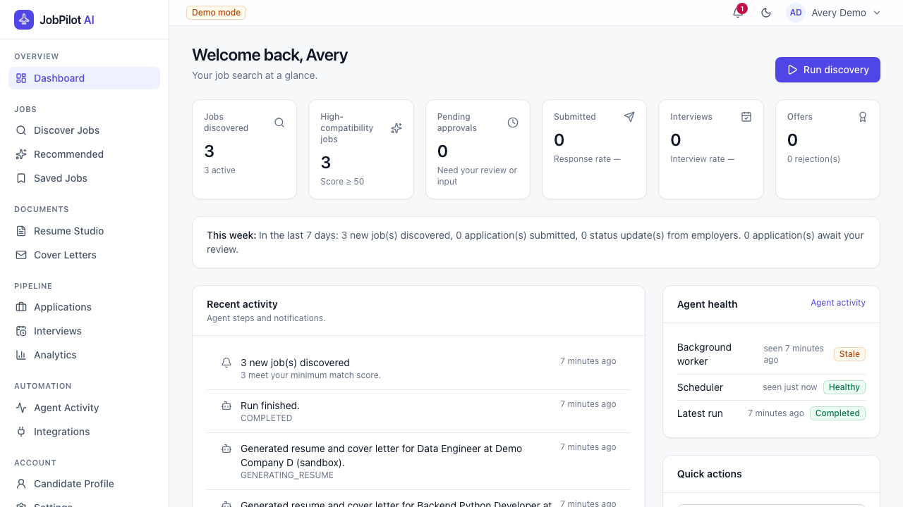
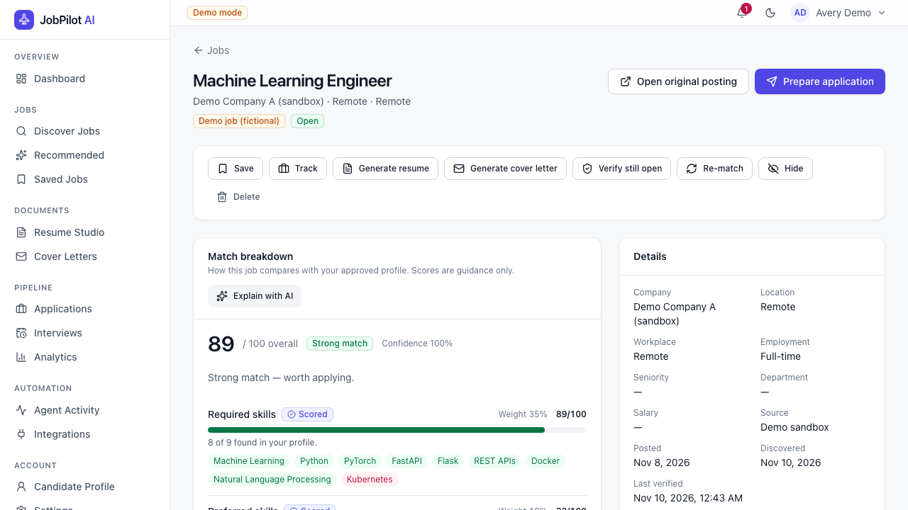
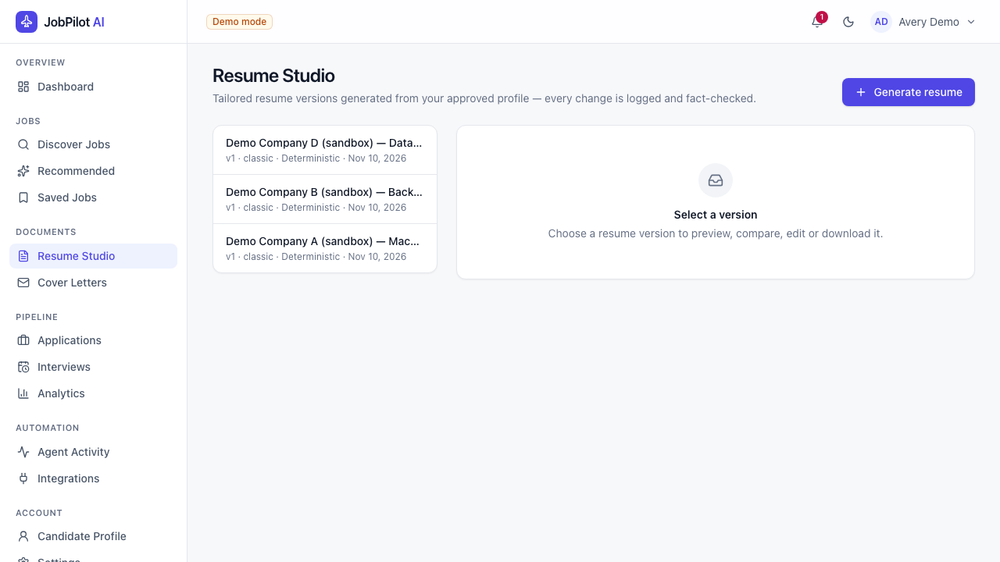
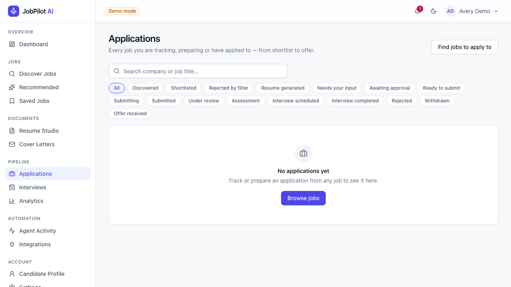
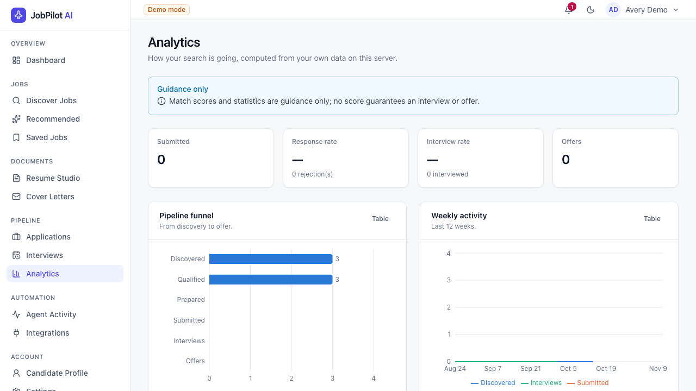
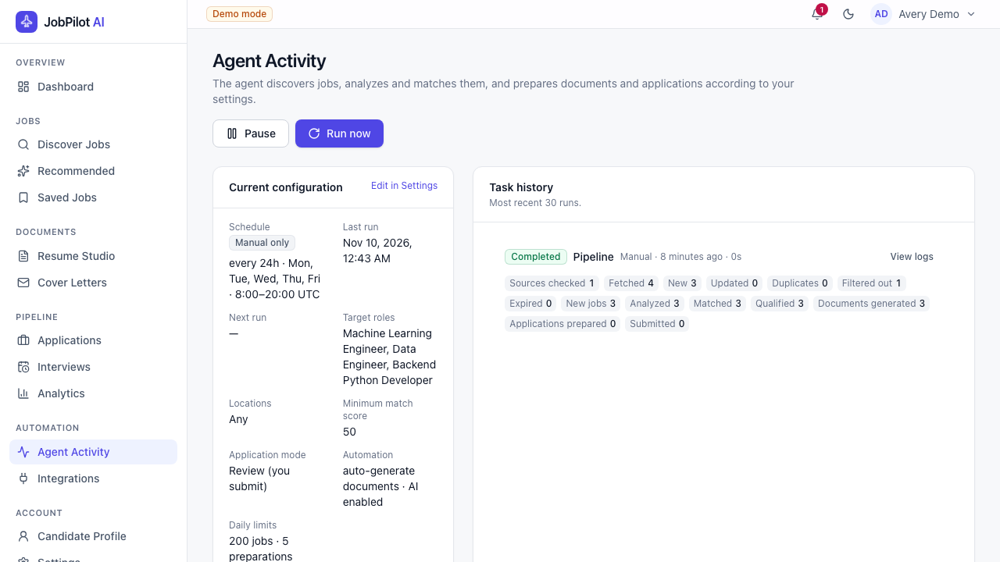
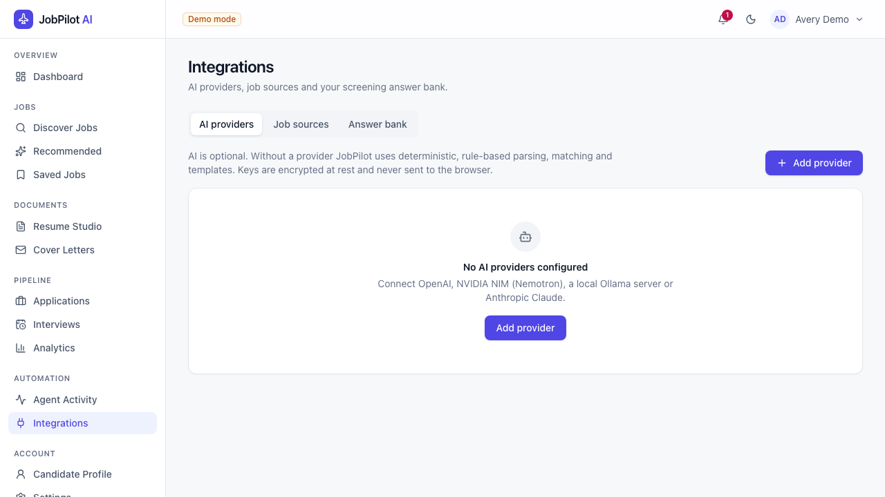

# JobPilot AI

**A self-hosted, open-source AI assistant for your job search** — discover relevant openings, see an
explainable match score, generate truthful tailored resumes and cover letters, prepare applications
for your approval, and track everything through to the offer.

Your data stays on your server. You bring your own AI provider (or none at all).

> JobPilot never invents experience. Every AI-generated sentence is fact-checked against the profile
> *you* approved; anything that adds skills, employers, numbers or credentials you don't have is rejected.



<details><summary>More screenshots (synthetic demo data)</summary>

| Explainable match | Resume Studio | Applications |
|---|---|---|
|  |  |  |
| **Analytics** | **Agent activity** | **Integrations** |
|  |  |  |

</details>

---

## What it does

| Stage | What happens |
|---|---|
| **Onboarding** | Upload a PDF/DOCX resume → structured profile is extracted (rule-based, optionally AI-assisted with a grounding check) → you review, edit and approve it. The original file is stored unchanged. |
| **Discovery** | Runs around the clock (every 15 minutes by default): a built-in directory of 123 company job boards, job-alert emails from LinkedIn/Naukri/Wellfound/Instahyre, Adzuna, Remotive and Arbeitnow, plus any Greenhouse/Lever/Ashby board or career page you add. Filters, de-duplication across sources, expiry checks, and instant alerts for strong matches. Jobs found elsewhere are looked up on the company's own careers site so you can apply directly. |
| **Location** | Pick cities, or set the country to **India** for region mode: office/hybrid jobs anywhere in India plus remote roles open to India. Remote jobs limited to the US, UK, Europe etc. are dropped. |
| **Matching** | Weighted, configurable score from required/preferred skills, content similarity (TF-IDF or embeddings), experience, title alignment, education and location — every component explained. Title matching understands common variants (Full-Stack/Fullstack, Backend/Back End, LLM/AI/GenAI Engineer). Missing profile data is shown as *unknown*, never as a gap. |
| **Resume Studio** | Per-job tailored resume: relevant skills first, bullets reordered, best projects selected, optional AI rephrasing with fact-checking. ATS-friendly DOCX + PDF, 4 templates, version history, side-by-side comparison with your original. |
| **Cover letters** | Concise letters from verified facts (template or AI + fact-check), editable, exportable. |
| **Applications** | Form fields are inspected and mapped to your verified data; unknown screening questions stop the process and ask you. **Review**, **Assisted** (pre-fill, you submit) or **Authorized automation** modes. Never bypasses CAPTCHA/MFA/logins, never applies twice. |
| **Tracking & analytics** | Full status pipeline, interviews, notes, follow-ups, audit trail; response/interview rates by source, role, company and resume version; weekly reports. |
| **Agent** | Background pipeline (discover → analyse → match → generate → prepare) with schedules, daily limits, pause/resume/cancel, locks, retries and logs. |

### Supported integrations — honestly

| Integration | Status |
|---|---|
| Built-in company directory (123 verified companies on Greenhouse/Lever/Ashby, incl. many hiring in India — Paytm, Meesho, CRED, Groww, Sarvam AI, Zeta, Tekion, DevRev, Databricks…; ~11k+ open jobs) | ✅ Searched automatically, no links needed |
| Adzuna (aggregates thousands of job sites; free API key) | ✅ Search by your roles + locations |
| Job-alert emails: LinkedIn, Naukri, Wellfound, Instahyre, Indeed, Foundit, Glassdoor | ✅ Imported automatically from your inbox (read-only IMAP) |
| Find the same job on the company's own careers board | ✅ Full description + apply directly with the employer |
| Remotive (remote jobs), Arbeitnow (Europe) | ✅ Free public APIs, checked within their usage limits |
| Greenhouse / Lever / Ashby boards you add, career pages with schema.org `JobPosting` | ✅ |
| Sandbox employer portal (`DEMO_MODE`) | ✅ Full automated submission, for demos/tests only |
| Logging into LinkedIn/Naukri/etc. to search or "Easy Apply" | ❌ Not done — their terms forbid bots and accounts get banned. Their jobs arrive via alert emails instead. |
| Automated *submission* to real employers | ❌ Deliberately not supported — JobPilot pre-fills, you submit. See [docs/INTEGRATIONS.md](docs/INTEGRATIONS.md). |

AI providers: any **OpenAI-compatible** endpoint (Groq, Google Gemini, OpenAI, NVIDIA NIM / Nemotron,
OpenRouter, Ollama, vLLM, LM Studio…) and **Anthropic Claude**. Groq and Gemini offer free keys without a
card. Everything also works with **no AI provider** configured; an AI provider makes tailoring much better.

---

## Quick start (Docker)

Requirements: Docker with Compose v2 (Docker Desktop, or Docker Engine on Linux). Nothing else —
no Python, Node, PostgreSQL, Redis or browsers on your machine.

```bash
git clone https://github.com/prakkhar19/jobpilot-ai.git
cd jobpilot-ai
cp .env.example .env          # or: make init-env   (generates random secrets)
docker compose up --build -d
```

Open **http://localhost:8080**, create your account (the first account becomes the administrator),
and follow the onboarding wizard.

First build takes a few minutes (the worker image includes a headless Chromium). Check status with
`docker compose ps` — all services should become `healthy`.

**Try it safely:** set `DEMO_MODE=true` in `.env` and restart (`docker compose up -d`). A clearly labelled
sandbox job board with fictional postings and a mock employer portal let you run the entire
workflow, including automated submission, without contacting any real employer.

### Configure an AI provider (optional)

*Integrations → AI providers → Add*. Examples:

| Provider | Base URL | Model |
|---|---|---|
| Groq (free key, no card) | `https://api.groq.com/openai/v1` | e.g. `openai/gpt-oss-120b` |
| Google Gemini (free key, no card) | `https://generativelanguage.googleapis.com/v1beta/openai` | e.g. `gemini-2.5-flash` |
| OpenAI | `https://api.openai.com/v1` | e.g. `gpt-4o-mini` |
| NVIDIA NIM (Nemotron) | `https://integrate.api.nvidia.com/v1` | e.g. `nvidia/llama-3.3-nemotron-super-49b-v1` |
| Ollama on your machine | `http://host.docker.internal:11434/v1` | e.g. `llama3.1` |
| Anthropic | *(leave empty)* | `claude-opus-5-5` |

Keys are encrypted at rest and never sent to the browser. Use **Test** to verify connectivity.
Free model names change often — check the provider's current model list if **Test** fails.

### Get jobs from LinkedIn, Naukri, Wellfound, Instahyre

1. Turn on **email job alerts** on those sites for your roles.
2. In Gmail, create an **App Password** (Google Account → Security → 2-Step Verification → App passwords).
3. *Integrations → Add source → Job-alert emails*: IMAP server `imap.gmail.com`, your address, the App Password.

JobPilot reads only alert emails from those senders, read-only — nothing is marked read, moved or deleted.

### Everyday commands

```bash
make up              # build + start
make down            # stop (data is kept)
make logs            # follow logs
make backup          # database + files → ./backups/
make restore DIR=backups/jobpilot-<timestamp>
make reset-password EMAIL=you@example.com   # prints a reset link (when SMTP isn't configured)
```

---

## Use it from your phone or share it with friends

By default JobPilot listens only on `localhost`. Two ways to reach it from anywhere over HTTPS:

**1. From your own computer — free, no card ([Tailscale Funnel](https://tailscale.com/kb/1223/funnel))**

1. Install Tailscale (`brew install --cask tailscale-app` on macOS), open it and log in.
2. In the Tailscale admin console enable **HTTPS** (DNS page).
3. Run `./scripts/go-public.sh` and approve Funnel if asked. It prints your public URL
   (`https://<machine>.<tailnet>.ts.net`), switches on secure cookies and multi-user mode.

Each friend signs up with their own account; tenant isolation keeps everyone's data private. When
everyone has joined, set `ALLOW_REGISTRATION=false` in `.env` and run `docker compose up -d`.
Stop sharing with `./scripts/go-public.sh off`. The link only works while the computer is on and awake.

**2. On a server (always on)**

Any Ubuntu VPS with 4 GB RAM works (e.g. a student cloud credit, or a low-cost VPS paid by UPI/card):

```bash
./scripts/deploy-to-server.sh ubuntu@<server-ip> [path/to/ssh-key]
```

This copies the project (never your `.env`, data or backups), installs Docker and Tailscale, creates a
fresh `.env` with random secrets and starts the stack with daily backups. Alternatively put it behind
an HTTPS reverse proxy (e.g. Caddy) with `COOKIE_SECURE=true` and `PUBLIC_BASE_URL=https://your-domain`.
PostgreSQL, Redis and the browser automation are never exposed. Details: [docs/DEPLOYMENT.md](docs/DEPLOYMENT.md).

**Password reset emails** need SMTP (`SMTP_HOST`, `SMTP_USERNAME`, `SMTP_PASSWORD`, `SMTP_FROM` — a Gmail App Password
works with `smtp.gmail.com:587`). Without SMTP, an admin can run `make reset-password EMAIL=…` to get a
one-hour reset link.

## Documentation

| | |
|---|---|
| [Architecture](docs/ARCHITECTURE.md) | Components, request flow, tenant isolation, agent pipeline |
| [Database](docs/DATABASE.md) | Tables, ownership and deletion behaviour |
| [API](docs/API.md) | REST API overview (OpenAPI at `/api/docs` in development) |
| [Integrations](docs/INTEGRATIONS.md) | Job sources, application providers, AI providers, what is unsupported and why |
| [Deployment](docs/DEPLOYMENT.md) | VPS + HTTPS, upgrades, hardening |
| [Backup & restore](docs/BACKUP_RESTORE.md) | Backups, restores, safe reset |
| [Environment variables](docs/ENVIRONMENT.md) | Every configuration option |
| [Development](docs/DEVELOPMENT.md) | Local setup, tests, adding integrations |
| [Troubleshooting](docs/TROUBLESHOOTING.md) | Common problems |
| [Known limitations](docs/LIMITATIONS.md) | What it doesn't do (yet) |
| [Release checklist](docs/RELEASE_CHECKLIST.md) | For maintainers |
| [Implementation plan](docs/IMPLEMENTATION_PLAN.md) | Build checklist and verification status |

## Responsible use

* Apply only to jobs you actually want; JobPilot favours relevance over volume and enforces daily limits.
* Review every application. Authorized automation exists only for providers that permit it and only after
  you explicitly enable it.
* Respect each site's terms of service. JobPilot uses public APIs, honours robots.txt for HTML pages,
  rate-limits itself, and never bypasses CAPTCHAs, MFA, paywalls or logins.
* Match scores are guidance. **No score guarantees an interview or an offer.**

## Contributing & security

See [CONTRIBUTING.md](CONTRIBUTING.md). Report vulnerabilities privately as described in [SECURITY.md](SECURITY.md).

## License

[MIT](LICENSE)
